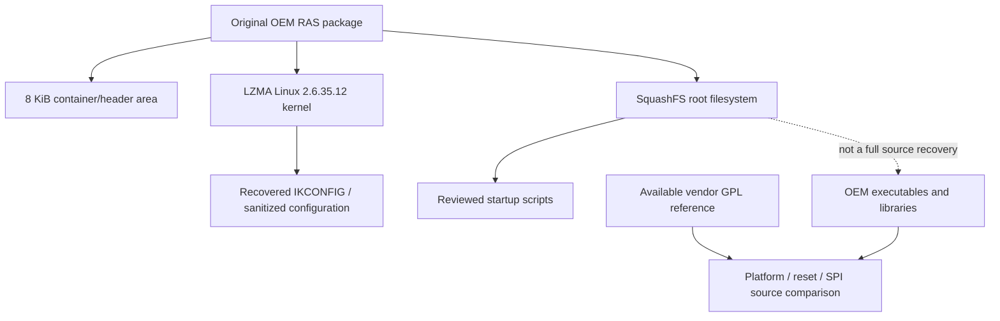

# HGW500 original OEM firmware analysis

> Public source snapshot. [Scope, provenance and verification](docs/PUBLIC_SNAPSHOT.md).

This repository explains the structure of the original HGW500 firmware and preserves the reviewed material recovered from it. It contains container analysis, a sanitized kernel configuration, exact selected startup scripts and vendor GPL references. Recovery and native decompilation are partial.

## How this component fits



This diagram shows software ownership and analysis flow, not a complete board schematic.
The [system architecture](docs/SYSTEM_ARCHITECTURE.md) explains the ARC750 host,
MuC, AuC, DSP and Realtek 8051, with their memory and firmware boundaries.

## What is established

| Area | Recorded scope |
| --- | --- |
| Input identity | Generic OEM package: 6,729,728 bytes; SHA-256 f39ed40cc66010287574bdc41c9fc18a6ba7d674f7c0acd7d7d47f8ab633a42f. |
| Container | 8,192-byte header area, LZMA kernel and aligned little-endian SquashFS. Preserved metadata records valid header and payload CRCs. |
| Recovered material | 20 exact startup/declaration scripts, sanitized Linux 2.6.35.12 configuration and a 42-file source manifest. A credential-bearing file is intentionally excluded. |
| Source gap | Vendor GPL v37.4.0.62.1 is a reference for the v37.4.0.89 binary lineage, not proof that all original executable source has been recovered. |

## Start reading here

1. [Component handoff](docs/PROJECT_HANDOFF.md): inputs, evidence and next work.
2. [System architecture](docs/SYSTEM_ARCHITECTURE.md): processors and firmware families.
3. [Firmware contents](docs/FIRMWARE_MAP.md): OEM, Core Boot R1 and API v2 R3.
4. [Repository map](docs/REPOSITORY_MAP.md): host drivers, payloads and integration.
5. [Published checkout availability](docs/CHECKOUT_AVAILABILITY.md): actual remote source inventory.
6. [Preserved technical notes](docs/REFERENCE_NOTES.md): detailed earlier results, with workstation paths normalized.

## Work in progress

Continue executable/kernel reconstruction and attribution of memory reservations. Own reset-to-DDR startup and the full 128 MiB are not qualified by isolated pattern tests. Keep generic firmware contents separate from flash identity, calibration, keys and personalized configuration.

## Offline verification


```sh
python tools/verify_public_export.py
```

This checks the published file inventory. Original preservation verifiers and
receipts describe the private source checkpoint; they can require omitted native
databases or external inputs and are not a fresh public-snapshot qualification.

## Preservation and scope

This is a public source snapshot; per-unit data and original private histories remain private. Original vendor/GPL source, notices, comments,
carriers and immutable evidence retain their authorship and provenance. Derived
C is labelled as inferred analysis, not silently presented as original source.
Credentials, unit identity, calibration, personalized rootfs/flash images and
workstation-specific configuration stay outside documentation exports.

Documentation prepared 2026-11-10 from recorded source/evidence. No device access,
firmware installation, radio change or new physical qualification is implied.
